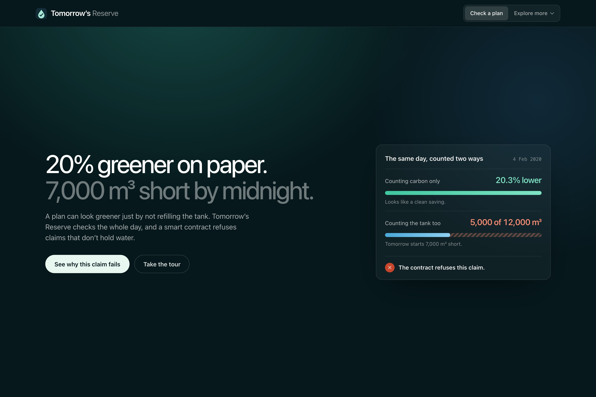
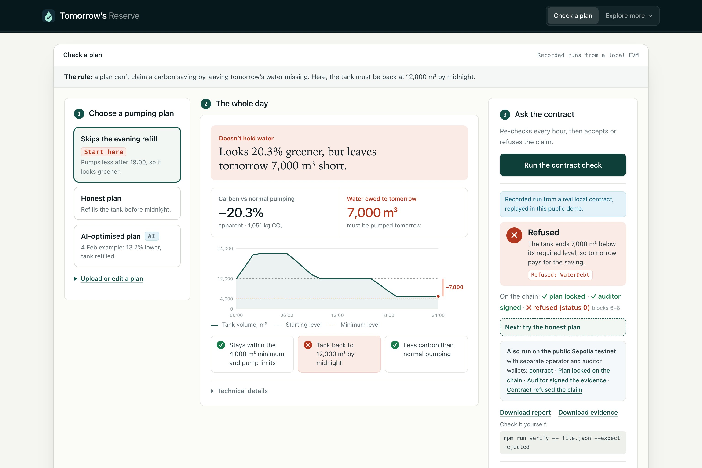
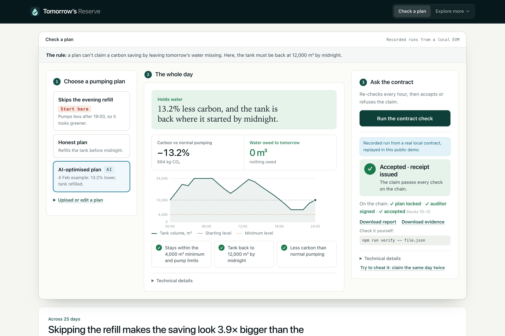

# Tomorrow’s Reserve

**Carbon savings without borrowing tomorrow’s water.**

[Live demo](https://tomorrows-reserve.vercel.app/) · [Public Sepolia refusal](https://sepolia.etherscan.io/address/0xF839720718187039Afa75ceA1A09a7d57786BC84) · [Public Sepolia acceptance](https://sepolia.etherscan.io/address/0xFf4489bd9f9d12658151B6b7d7222A99e4d3cA30) · [Full project README](pumpproof/README.md)



## The problem

Water utilities can cut the carbon of pumping by moving it into hours when the grid is cleaner. But a plan can also look greener simply by **not refilling the tank**. Tomorrow inherits the missing water and the pumping that was put off, so the "saving" was borrowed.

Tomorrow’s Reserve checks a pumping-carbon claim against the whole day’s water balance. A smart contract re-checks every hour and **refuses** any claim that leaves tomorrow short.

## How it works

1. **A utility analyst** supplies yesterday’s 24 hourly pumping values (CSV or JSON). The values are never repaired or optimised.
2. **The checker** follows the tank hour by hour and compares attributed CO₂ with normal pumping.
3. **The contract** (Solidity) locks the exact plan, takes the auditor’s signature on the evidence, then accepts with a receipt or refuses with a reason (for example `WaterDebt`). A receipt needs the auditor’s signature first; the operator cannot issue one alone.
4. **An auditor or lender** downloads the signed evidence and re-checks it without our app before relying on the claim.

| Depleted plan: refused | AI-optimised plan: accepted |
|---|---|
|  |  |

## Check it yourself in five minutes

1. Open the [live demo](https://tomorrows-reserve.vercel.app/) and run **Skips the evening refill**: about 20% greener on paper, 7,000 m³ short, refused (`WaterDebt`).
2. Pick **Honest plan** or **AI-optimised plan** and run the check: storage restored, receipt issued.
3. Download the evidence file and verify it:

   ```sh
   cd pumpproof
   npm ci
   npm run verify -- accepted.json
   npm run verify -- refused.json --expect rejected
   ```

   The verifier replays the exact plan on a fresh local chain. Change one number in a copy and verification fails. A verified refusal stays a refusal.

The public demo replays recorded runs from a local chain. For fresh contract runs, run it locally: `cd pumpproof && npm ci && npm start`, then open http://127.0.0.1:4317/.

## Results (25 simulated February 2020 days)

| Plan | Attributed CO₂ reduction, including failed days | Eligible days |
|---|---|---|
| Skips the evening refill | 19.36% (apparent) | 0 / 25 |
| AI forecast model | 9.44% | 24 / 25 |
| Weekly persistence | 8.68% | 23 / 25 |
| Honest clock/tank rule | 4.92% | 22 / 25 |

All 50 rule plans ran through the contract: 22 accepted, 3 refused for no carbon benefit and 25 refused for water debt. Skipping the refill makes the saving look 3.9× bigger than the honest rule, yet no depleted plan qualifies. Operating margins differ, so equal safety is not established.

**Public chain:** the same 4 February refusal and acceptance also ran on Ethereum’s public Sepolia test network with separate operator and auditor keys ([refusal](https://sepolia.etherscan.io/address/0xF839720718187039Afa75ceA1A09a7d57786BC84), [acceptance](https://sepolia.etherscan.io/address/0xFf4489bd9f9d12658151B6b7d7222A99e4d3cA30)). These are separate keys, not independent organisations.

## Accounting concepts we follow

The check maps to concepts auditors already use; it is not a certified methodology. Carbon is hourly grid-average intensity × pumping energy (as in the GHG Protocol Scope 2 location-based method, applied hour by hour); normal pumping is the baseline; one tank and one day is the boundary; savings shifted into tomorrow (leakage) are refused; and a separate auditor key must sign before any receipt.

## Limits

A retrospective proof of concept: the tank, pumps and plans are simulated, both roles run on one machine, and the figures are timing-based attributed CO₂, not measured avoided emissions. No utility trial has been done yet; a read-only shadow trial is the proposed next step. No carbon credits, tokens or payments are issued.

## Repository

- [`pumpproof/`](pumpproof/): the application, contract, verifier, data and tests (PumpProof was the codename). Start with its [README](pumpproof/README.md).
- [`pumpproof/docs/submission/`](pumpproof/docs/submission/): submission documents, results and verification notes.
- Code: [MIT licence](LICENSE). Data keeps its own licences: see [NOTICE](NOTICE).
